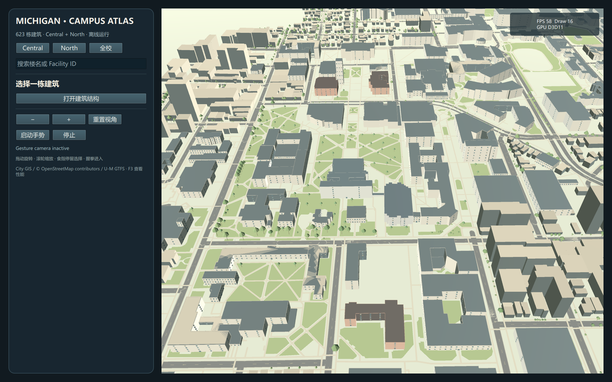
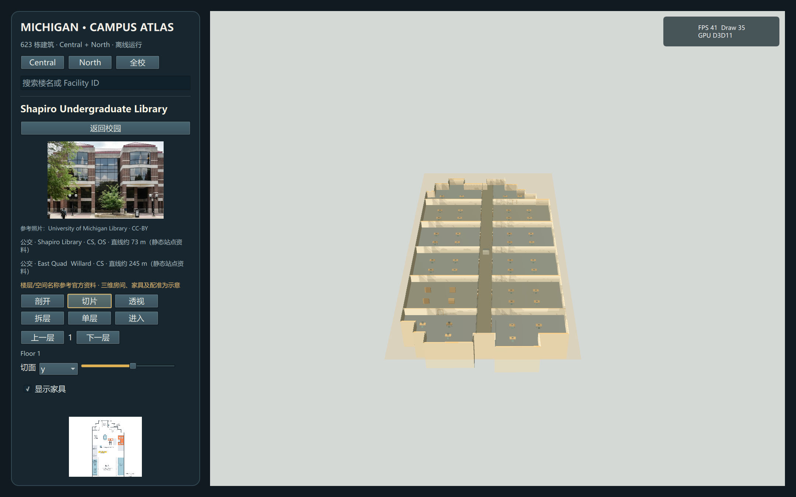
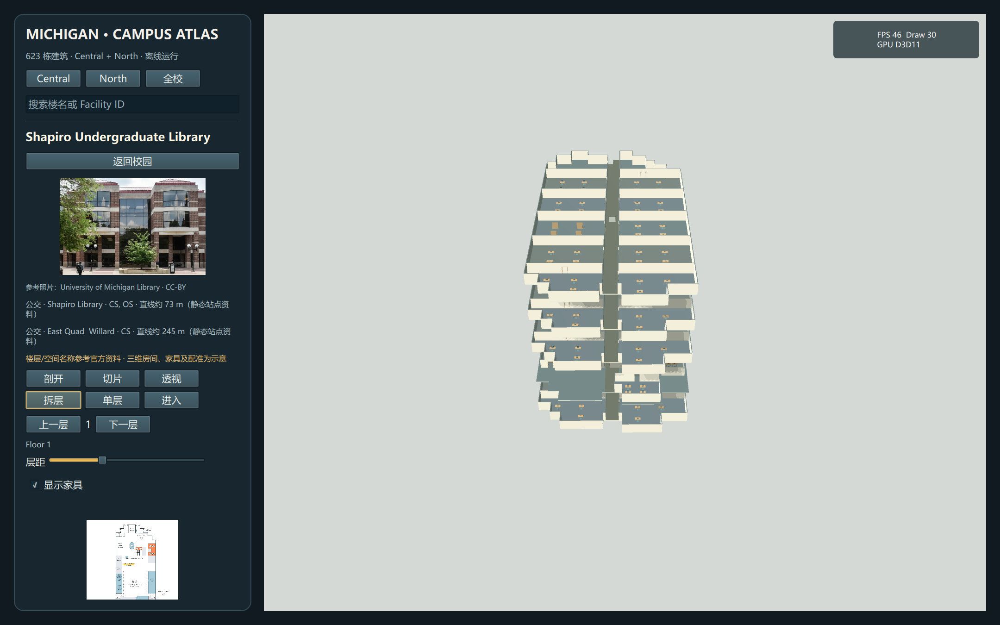
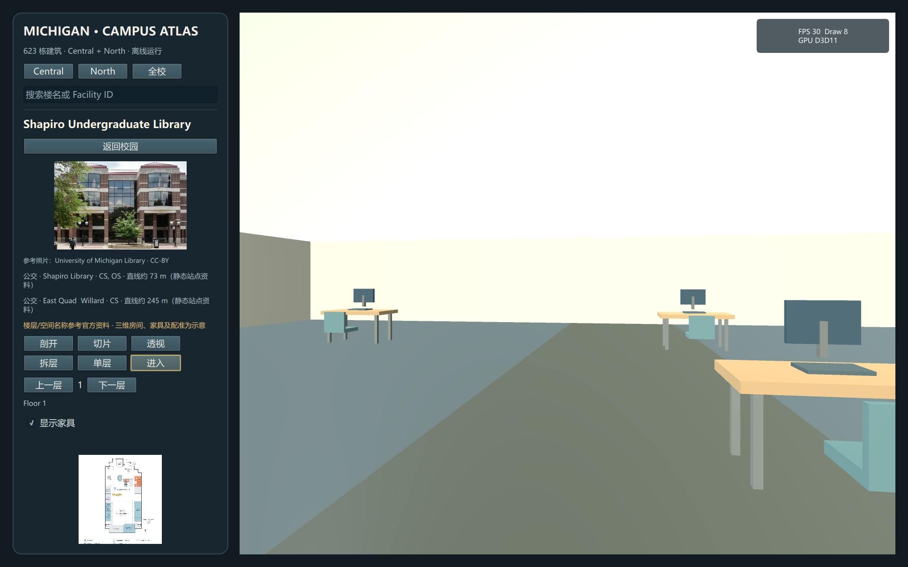

# 密西根大学本地 3D 校园地图报告

**交付内容、真实程度与下一步重点**

报告日期：2026-10-13 · 实现分支：`codex/campus-interiors-environment` · 实现基线：`4b64186`

本报告根据当前仓库、已保存画面和 2026-10-12 的验证记录编写。本次整理报告没有重新运行性能或摄像头测试。文中的竞品资料也是 10 月 12 日的调研快照。

## 01 · 目前做到了什么

现在已经有一个**在 Windows 本地运行的原生 3D 校园探索应用**。它覆盖 Central Campus 和 North Campus 的建筑记录，加入周边建筑、道路、步道、树木、地面和公交站；选中建筑后，可以剖开、切片、透明查看、展开楼层，并进入室内示意模型。

**你要求的交互框架已经落地，逼真程度仍有明显差距**。现有画面是简化的三维模型：建筑具有地理轮廓，室内具有墙、走廊和家具，但没有完成全校逐栋外立面复原，也没有把每张楼层图准确描成真实墙体。它目前适合探索和演示空间关系，不能称为完整实测数字孪生。

| 你提出的要求 | 当前结果 | 完成程度 |
| --- | --- | --- |
| 新分支，项目在本机运行，不用浏览器 | Qt Quick 3D 原生窗口；地图、参考图和识别模型从本地读取 | 已实现 |
| 地图扩到 Central 和 North | 623 个校园建筑记录，并补上 2,174 个周边建筑轮廓 | 已实现数据覆盖，未逐栋核验 |
| 道路、其他建筑、树、人和环境 | 道路、步道、地面、树木、静态行人及小型环境物件已加入 | 已实现；部分为设计示意 |
| 广泛找楼的照片和楼层图 | 五组重点建筑档案；28 张官方平面图有离线 PDF/PNG；三张照片保存本地 | 部分实现，未覆盖全校 |
| 手势选楼、进入建筑、查看内部 | 识别结果已接入选择、进入、切片、换层、移动和返回 | 操作逻辑已实现，实体手部未实测 |
| 像手术视图一样看透三维结构 | 六种视图共享同一栋建筑，支持 X/Y/Z 剖切和楼层展开 | 已实现 |
| 尽可能接近真实结构、照片级画面 | 真实坐标与官方名称结合生成的墙体、家具和通用外观 | 尚未达到 |
| 提升性能，全部本地 | 静态模型合批、预编译缓存、室内按需加载；当前本机环境已配置 | 已实现；不保证稳定 60 FPS |
| 最终提交、推送 | 实现提交 `4b64186` 已推送到上述分支 | 已完成 |

## 02 · 与之前的版本有什么区别

“八栋重点建筑”和“校园整体覆盖”是两个不同的范围。之前的本地版本已经加载 623 个建筑记录，其中八栋具有额外细节；本次重点是补环境和室内探索，不能把它描述成这次才从八栋扩到 623 栋。

| 阶段 | 主要能力 | 当时的边界 |
| --- | --- | --- |
| 早期浏览器手势与校园演示 | 摄像头手势、地图平移缩放、重点建筑展示 | 浏览器运行；不能代表全校详细建模 |
| 扩展前的本地原生版本 | Central + North 的 623 个建筑记录；八栋重点建筑；本地手势控制 | 场景主要由建筑体量构成，缺少本次完整环境图层与室内探索 |
| 当前分支 | 保留校园覆盖，加入环境、建筑参考资料、示意内部、六种结构视图和室内移动 | 官方资料覆盖集中在五组建筑；大量外观与室内细节仍为生成示意 |

**当前版本的核心变化是从“看校园建筑”进入“选一栋楼，观察楼层关系，再走进内部”**。原生运行解决了依赖网页的问题，真实建模仍需要继续补资料和人工配准。

## 03 · 校园外部与环境数据



*图 1：Central Campus 环境视角。可见建筑群、道路、步道、树木和地面；当前外立面仍以通用窗格和简化材质为主。截图中的 58 FPS 是单次显示值。*

| 图层 | 当前数量 | 有来源的内容 | 仍属估计或示意的内容 |
| --- | --- | --- | --- |
| 校园建筑 | 623 个记录 | 名称、校园归属、外部轮廓等已有数据 | 通用门窗、部分高度解释、屋顶和室内 |
| 周边建筑 | 2,174 个轮廓 | 市政建筑轮廓与相关属性 | 细部外观、屋顶形状 |
| 道路 | 966 段 | 市政道路中心线 | 显示宽度和表面表现 |
| 步道 | 4,754 段 | OSM 路径坐标 | 宽度、铺装细节 |
| 地面区域 | 673 个 | 公园、林地、草地等来源边界 | 材质和简化地表表现 |
| 树木 | 3,562 个记录 | 市政树木位置及相关属性 | 树冠形状、部分高度表现；不能代表校园全部树木 |
| 公交站 | 104 个 | U-M 静态 GTFS 站点和线路代码 | 简化站点外观；没有实时到站 |

另外最多加入 160 棵补充树木，以及 90 个行人／长椅类物件来表达尺度。这些是场景设计，不是现场人员、座椅或树木分布的记录，行人也没有实时活动模拟。

环境资料访问日期为 2026-10-12；OSM 快照时间为 **2026-07-24 11:04:51 UTC**。不同图层来自不同时间的独立快照，不能据此保证当前施工、路线或建筑状态全部一致。623 是建筑数据记录数，不是已核验的独立建筑实物数。

**公交信息**：选楼后最多显示 250 米内的三个附近站点，距离按建筑中心到站点的直线距离计算，不是步行路线距离。线路代码来自静态资料。

数据依据见 [环境资产及来源记录](../../native/assets/campus_environment.json)、[校园建筑数据](../../src/campusBuildings.json) 和 [建筑轮廓](../../src/campusBuildingFootprints.json)。

## 04 · 建筑资料与室内真实程度

| 建筑档案 | 官方资料支持的目录条目 | 本地官方平面图 | 当前建模边界 |
| --- | --- | --- | --- |
| Shapiro Library | 地下层及 1–4 层，共 5 个 | 6 张，包含二层房间详图 | 楼层名称与部分空间名称有来源；墙、家具和配准为示意 |
| Duderstadt Center | 地下层及 1–3 层，共 4 个 | 4 张 | 北校重点室内示例；未逐墙描图 |
| Hatcher Library | 南北翼合计 18 个，包含夹层目录 | 18 张 | 可切换南北翼；两翼没有各自实测的三维占地配准 |
| Michigan Union | Ground 至 Fourth，共 5 个 | 未打包平面图 | 官方楼层与部分空间名称；内部结构为示意 |
| Beyster Building | 一层 1 个 | 官方 PDF 来源链接，未打包 | 一层有名称依据；另三层明确标为未核实示意 |

合计 **33 个有官方楼层／空间信息支持的目录条目，另有 3 个推定条目**。这不等于 33 层已经完成精确墙体复原，也不等于全校建筑都有真实室内图。五组档案通过设施编号匹配地图记录，不宜直接用“五除以 623”计算实物楼的覆盖率。

28 张平面图保留原始 PDF，并生成 PNG 用于本地对照。三张本地照片是 Shapiro 外观、Shapiro Clark Commons 和 Duderstadt 外观；其他研究照片保留来源链接。照片目前用于参考展示，不是遍布全校外墙的贴图。

### 模型中哪些真实，哪些是设计

| 证据层次 | 可以这样理解 | 不能据此推断 |
| --- | --- | --- |
| 来源坐标与外轮廓 | 建筑、道路、步道等有地理数据依据 | 内部墙体、门的位置都真实 |
| 官方楼层／空间名称 | 对应资料确实列出该楼层或空间 | 三维模型中的房间边界已准确复原 |
| 近似区域配准 | 将图上的功能区大致对应到三维楼层 | 已按图纸比例逐墙描绘 |
| 生成的内部结构 | 可观察楼板、墙、门、走廊、楼梯、桌椅和书架 | 家具位置、楼层净高、通行关系已实测 |
| 无图纸建筑的内部 | 按真实外轮廓裁出可探索示意 | 这是该建筑的实际房间布局 |

当前楼层高度等参数采用设计假设，例如约 3.6 米的层间距。界面持续标注内部示意，并允许放大官方楼层图对照。现阶段最明显的缺口是**官方平面图尚未转为准确的三维墙体和门洞**。

资料明细见 [建筑参考目录](../../native/building_references.json)、[楼层图来源清单](../../native/assets/references/floorplan_manifest.json)、[照片来源](../../native/assets/references/photo_sources.json) 和 [资产署名](../../native/assets/references/ATTRIBUTION.md)。

## 05 · 如何看透结构与进入楼内



*图 2：Shapiro 的切片视图。原始楼层图与三维示意并列；三维墙体还没有准确贴合原图。*

| 视图 | 用来解决什么问题 | 当前操作 |
| --- | --- | --- |
| 剖开 / Dollhouse | 屋顶和外部遮挡挡住内部 | 裁去部分遮挡，观察整体内部 |
| 切片 | 想看某一高度或沿某个方向的内部关系 | X/Y/Z 轴加切面滑块；食指可控制切片位置 |
| 透视 / X-ray | 想保留外壳，同时看内部 | 外壳透明度滑块；内部使用固定的透明表现 |
| 拆层 | 多层叠在一起难以看清 | 调整楼层间距，沿竖直方向展开 |
| 单层 | 只关注当前楼层 | 显示当前层，切换上层／下层 |
| 进入 | 想从人在楼内的尺度理解空间 | 室内视角、前后移动和转向 |

“像四维看三维”在这里落成了**改变遮挡、剖切深度和楼层间距**，让你同时理解外部体量与内部关系。它展示的是已经建好的三维内容，不会自动从外轮廓推算出真实内部。



*图 3：楼层展开用于比较层序和空间关系。楼梯、层高与布局仍是示意。*

### 手势与常规控制

| 操作 | 校园视图 | 结构视图 | 室内视图 |
| --- | --- | --- | --- |
| 食指指向并停留 | 约 850 毫秒停留选楼 | 切片模式控制切面；其他模式可选择示意空间 | 选择逻辑依当前模式 |
| 握拳 | 已选楼时打开结构 | 切到室内 | 切回剖开 |
| 张开手掌并移动 | 平移视角 | 平移视角 | 环顾 |
| 拇指上／下 | 放大／缩小 | 换层，并进入单层模式 | 前进／后退约 1.8 米 |
| Victory | 复位校园视角 | 返回校园并复位 | 返回校园并复位 |

手势有识别置信度阈值和约 0.7 秒的离散操作冷却。握拳进入楼内的实际顺序是：**指向选楼 → 握拳打开结构 → 松开后再次握拳进入**。一直握拳不会连续触发；拇指移动也需要重新做出手势，不是持续举着就一直行走。

摄像头默认关闭，由“启动手势”按钮开启，界面显示识别状态。鼠标和按钮可完成主要操作；室内可用 W/S 移动、A/D 转向、右键拖动环顾、滚轮移动。楼层切换通过按钮或手势完成，尚未实现走楼梯连续上下楼。



*图 4：已能进入示意室内。桌椅、墙面和照明仍很简化，这是当前逼真程度的直接证据。*

墙体、桌椅、书架和楼梯参与碰撞；关掉家具显示也会取消对应家具的阻挡。房间选择可更新名称和楼层，但尚未实现精确房间轮廓的独立高亮。透视模式也没有为每一类构件提供完整的独立透明度控制。

## 06 · 竞品调查与借鉴结果

以前的项目档案已有 Matterport、Concept3D、MazeMap、Mappedin 等讨论，剖视方向也已经出现过。本次将这些方向落实到本地模型。下表依据 2026-10-12 保存的官方资料，不是对竞品软件的本机实测，也没有复制其商业模型。

| 参考 | 值得借鉴的做法 | 当前已实现的对应能力 | 仍有的差距 |
| --- | --- | --- | --- |
| [Concept3D](https://help.concept3d.com/hc/en-us/articles/360017771254-Concept3D-Map-Platform-Overview) | 校园建筑与道路、环境、搜索和媒体一体展示 | 校园环境、建筑搜索、参考照片与公交站资料 | 建筑辨识度、校园专属外观细节不足；官方预绘制图不能直接当作实时三维性能证据 |
| [Mappedin](https://developer.mappedin.com/android-sdk/stacked-maps) | 多楼层上下文与楼层展开 | 拆层、层间距、当前楼层选择 | 房间标签、可读性和精细地图表达仍需完善 |
| [MazeMap](https://www.mazemap.com/solutions/3d-maps) | 室内空间、家具与室内外关联 | 外部选楼后进入楼层，显示示意家具 | 尚无真实房间导航网络或完整定位能力 |
| [Matterport](https://matterport.com/matterport-academy/intro-to-showcase/intro-to-showcase) | Dollhouse、楼层选择、人在室内的视角 | 同楼切换整体、剖视、楼层和室内 | 没有扫描、照片纹理或真实深度采集；视觉差距最大 |
| [Autodesk Viewer](https://aps.autodesk.com/viewer-sdk) | 截面、构件展开与可见性 | X/Y/Z 切片、拆层、外壳透明度及家具开关 | 没有完整 BIM 构件信息和逐构件语义控制 |
| [ArcGIS Scene Viewer](https://doc.arcgis.com/en/arcgis-online/get-started/slice-scene-content.htm) | 剖切揭示墙和家具 | 原生材质裁剪显示内部 | 没有完整的图层排除与房间突出功能 |

**对比结论**：结构观察的基本操作已经具备。与成熟产品最大的差距是模型资料、准确配准、材质和场景细节，而不是再多加几个视图按钮。

Google Earth／Maps 的连续城市环境和照片级纹理是视觉目标。本次离线资产包实际采用独立市政 GIS、OSM、U-M 资料及自行生成网格，没有下载或抽取 Google 三维瓦片、网格和纹理。相关研究及来源见 [10 月 12 日调研报告](2026-10-12-campus-visual-realism.md)；本报告不把 Google 画面当作已交付效果。

## 07 · 性能方法与现有数据

### 为什么这样实现

- **原生渲染**：PySide6 / Qt Quick 3D 使用本机图形后端，不启动网页或 WebView。
- **静态模型合批**：校园外部和环境按模型／材质组合，减少逐个物件提交绘制的开销。
- **预编译缓存**：15 个静态网格约 5.75 MB，输入指纹可识别过期缓存。
- **室内按需生成**：只为选中的楼加载内部，避免首次启动就生成全校室内；切换视图复用模型。
- **识别工作与界面分开**：摄像头工作线程通过 Qt 信号传回识别结果，界面线程执行控制。

### 2026-10-12 本机观察

条件：Qt 6.8.3、D3D11、2160 × 1350 物理窗口、摄像头关闭；数值为移动视角时的短时渲染统计采样。

| 场景 | 观察帧率 | 绘制调用数 |
| --- | --- | --- |
| 校园外部 | 约 41–58 FPS | 16 |
| 切片 | 约 38–46 FPS 范围内 | 35 |
| 单层 | 约 38–46 FPS 范围内 | 6 |
| 楼层展开 | 约 38–46 FPS 范围内 | 30 |
| 透明透视 | 约 38–46 FPS 范围内 | 22 |
| 室内 | 约 30 FPS | 8 |
| 首次剖开热身样本 | 9 FPS | 剖开场景约 34 |

有效静态缓存读取约 0.2–0.5 秒，较宽的加载观察范围到 0.9 秒；这些数字**不包含 Python、界面和驱动的完整启动时间**。首次 Shapiro 室内生成约 3.2 秒，随后视图切换复用内部内容。

扩展前 2026-10-11 的记录约 21 FPS：1980 × 1230 窗口，73 个移动帧间隔，中位帧时 47.82 毫秒，P95 为 56.96 毫秒。新旧采样的窗口、方法和条件不同，**不能将 21 → 58 解释为已经证明的性能提升倍数**。

当前记录说明本机能运行扩展后的场景，但没有建立稳定 60 FPS 的证据。开启摄像头后、持续室内移动时和冷启动时的体验仍需要统一条件测量。

## 08 · 已验证与未验证

以下是 2026-10-12 的实现验证记录，本次报告没有重新执行。

| 项目 | 证据或状态 |
| --- | --- |
| 本地逻辑检查 | 18 项 Python 测试通过，覆盖 Qt 线程信号、参考楼层图、楼翼切换、凹形轮廓及移动阻挡等 |
| 原生画面 | 实际打开窗口检查六种结构视图，保存本报告的四张截图 |
| 室内转向 | 已确认转向信号改变相机朝向 |
| 手势接入 | 实际 Qt 信号路径及控制动作有检查 |
| 实体摄像头和手 | 未完成真人手势的端到端体验测试；不能据此承诺识别稳定、低延迟 |
| 全校精细建模 | 未完成全校逐楼外观和内部核验 |
| 离线运行 | 运行路径读取本地资料，没有运行时网络调用；未记录独立断网复测 |
| 性能验收 | 有本机短时采样，尚无统一条件长时基准、摄像头开启基准 |

**本机依赖已配置**。安装时遇到过临时目录和网络镜像问题，已修正启动脚本并用本机既有安装补齐识别依赖。换一台没有依赖的新电脑，首次配置可能需要下载软件包；“运行全本地”不等于“任何电脑首次安装都无需网络”。

## 09 · 下一步应优先做什么

建议下一轮先把一栋楼做准，再扩到更多楼。下面是报告建议，尚未作为新功能实现。

| 优先级 | 工作 | 验收结果 |
| --- | --- | --- |
| 1 | 选 Shapiro 或 Duderstadt，逐层描出墙、门、楼梯和功能区 | 三维模型可与官方图重叠对照，明确未核实区域，而非只有名称相同 |
| 2 | 补该楼外观照片和空间照片，制作专属材质与立面细节 | 从校园视图到近景都能辨认该楼，减少重复窗格和统一墙色 |
| 3 | 真人单手摄像头验收，并同时测帧率 | 实际完成选楼、两次握拳进入、环顾、换层／移动、Victory 返回；记录误触和延迟 |
| 4 | 统一测量冷启动、切换、室内移动和摄像头开启 | 同窗口、同视角、同机器给出中位数和 P95，不只看单次 FPS |
| 5 | 扩展北校建筑的资料与精确内部 | 每栋新增建筑都有来源、配准结果与示意区域说明 |

要接近 Matterport 或 Google Earth 的观感，需要真实照片纹理、测量／扫描或可靠三维资料，再加照明和材质处理。继续堆自动生成家具，可以增加复杂度，但不能替代真实墙体、外立面和纹理。

## 10 · 本地入口与交付位置

项目目录：`C:\Users\TerryZhu\.codex\worktrees\4b77\3DMap`

在该目录打开终端，运行：

```powershell
.\native\run.ps1
```

这是当前原生项目的启动入口；不需要原来的 `gesture-map.html` 或本地网页服务。程序打开后，可先用搜索选 Shapiro 或 Duderstadt，打开建筑结构，再查看楼层图和六种视图。摄像头由你点击开启。

| 交付项 | 位置 |
| --- | --- |
| 本报告图文版 | [离线 HTML 报告](2026-10-13-campus-map-report.html) |
| 本报告文字版 | [Markdown 报告](2026-10-13-campus-map-report.md) |
| 启动入口 | [native/run.ps1](../../native/run.ps1) |
| 运行说明与历史性能记录 | [native/README.md](../../native/README.md) |
| 本次实现记录 | [10 月 12 日交付记录](2026-10-12-native-delivery.md) |
| 竞品研究与旧讨论 | [竞品及真实感研究](2026-10-12-campus-visual-realism.md)、[项目上下文](../../PROJECT_CONTEXT.md)、[聊天档案](../../CLOUD_CHAT_ARCHIVE.md) |
| 实现提交 | [4b64186](https://github.com/2008Terry/3DMap/commit/4b641864d39ba3094d34fda4fd3f40de7a9d7c6d) |
| 当前开发分支 | [codex/campus-interiors-environment](https://github.com/2008Terry/3DMap/tree/codex/campus-interiors-environment) |

### 主要资料来源

- **楼层与空间**：[Shapiro](https://lib.umich.edu/visit-and-study/floor-plans/shapiro-library-floors/basement/)、[Duderstadt / Art, Architecture and Engineering Library](https://lib.umich.edu/visit-and-study/floor-plans/art-architecture-and-engineering-library-floors/basement/)、[Hatcher North](https://lib.umich.edu/visit-and-study/floor-plans/hatcher-library-north-floors/basement/)、[Michigan Union](https://uunions.umich.edu/union/)、[Beyster 一层图](https://cse.engin.umich.edu/wp-content/uploads/sites/3/2019/03/beyster_map.pdf)。各层独立 PDF 来源在本地清单中。
- **环境坐标**：[City of Ann Arbor 建筑数据](https://a2maps.a2gov.org/a2arcgis/rest/services/OSI/BuildingFootprints/FeatureServer/0)、[道路](https://a2maps.a2gov.org/a2arcgis/rest/services/RoadOwnership/MapServer/0)、[树木](https://a2maps.a2gov.org/a2arcgis/rest/services/TreeInventory/MapServer/0)、[OpenStreetMap](https://www.openstreetmap.org/copyright)、[U-M GTFS](https://webapps.fo.umich.edu/transit_uploads/google_transit.zip)。公园与林地等来源详见环境资产。
- **图片署名**：截图内的参考照片与楼层图来自 University of Michigan Library；平面图 PNG 为原 PDF 的转换版本。[Library 内容政策](https://lib.umich.edu/about-us/policies/copyright-policy/)、[CC BY 4.0](https://creativecommons.org/licenses/by/4.0/)、[本地资产署名](../../native/assets/references/ATTRIBUTION.md)。生成的三维室内与这些原图是不同资产。

**本次成果**：本地原生校园地图、环境图层和楼内结构探索已可使用；接下来提升真实感的关键是把真实资料准确变成模型，并完成真人手势与统一性能验收。
