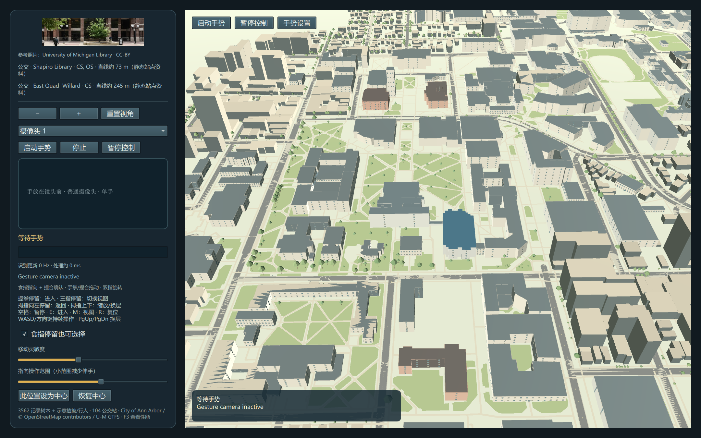

# 本地手势与地图交互优化

日期：2026-10-13。沿用用户对本地原生应用、普通摄像头、单手操作及自主实施的授权。

## 判断与方案

现有问题：15 Hz 的推理间隔额外叠加处理时间；识别信号可能在界面忙时排队；没有时间稳定判定；固定死区滤波；一次一跳的缩放和行走；缺少动作进度、暂停和输入仲裁。

比较三个路线：

1. 保留 MediaPipe Tasks 的已训练模型，改实时采集、过滤和控制层，并用已有关键点识别新增姿态。推荐；已有本地模型可复用，无新增推理网络。
2. 改 OpenCV Zoo / ONNX 手部关键点。需重做检测、跟踪、手势分类；Zoo 的相关模型同样来自 MediaPipe，没有本机比较证据证明更快。
3. 训练自定义识别模型。需要真实用户样本和独立评价数据；本次不以无数据训练宣称精度提升。

## 操作设计

| 输入 | 作用 |
| --- | --- |
| 食指 | 平滑光标；可停留选楼；切片模式扫描切面 |
| 拇指与食指捏合 | 接续最近的指向进行确认；保持捏合并拖动来平移地图，室内环顾 |
| 张开手掌移动 | 地图平移／室内环顾；放松或丢失手即停止 |
| 双指 V 移动 | 地图／建筑旋转；室内环顾。替代以前 V 立即复位的映射 |
| 拇指上／下 | 持续缩放；室内持续前进／后退；检查建筑时按间隔换层 |
| 握拳停留 | 打开选中建筑／进入内部；一次保持只触发一次，重新动作需松开 |
| 三指（食指、中指、无名指）停留 | 循环结构观察模式，不自动进入室内 |
| 拇指向屏幕左侧停留 | 逐级返回：室内到剖开，结构到校园；不强制复位校园视角 |
| 空格／暂停按钮 | 暂停地图响应，继续显示识别反馈；恢复后需要重新稳定姿态 |
| 键鼠／触控板 | 保留准确输入，补充连续按键、返回、换层、重置、捏合缩放 |

交互参数是可调整的设计默认值，不是 HCI 研究的普适结论。捏合闭合／松开采用不同阈值并按手掌宽度归一化；连续动作需约 120 ms 稳定，离散动作用约 550–650 ms 确认。One Euro 滤波减少低速抖动，快速动作提高截止频率。小范围舒适操作区、灵敏度和停留选择开关在原生面板中提供；可把舒适的食指位置设为指向中心，并恢复默认。校准后的两侧范围分别限制在可见相机坐标内。

## 管线与边界

- 单手、640×480、目标 30 帧采集；LIVE_STREAM 忙时由 SDK 丢弃输入，回调只保存最新结果。
- GUI 定时取最新结果；过期结果丢弃。250 ms 没有新观测时停止连续动作。
- 捏合、三指及侧向拇指由关键点几何规则判断，不伪装成新训练模型或概率置信度。
- GUI 以帧时间积分缩放／移动，速率有界；室内移动仍通过已有碰撞检查。
- 键鼠操作暂时让出手势控制，窗口失焦停止动作；恢复需重新稳定，避免争抢视角。
- 摄像头需要用户开启，无运行时网络。显示骨架而非上传视频；提供摄像头索引选择和识别耗时／更新频率反馈。

识别 Hz 是结果更新频率，毫秒是提交图像到回调的平滑耗时，不是相机到屏幕的总延迟。30 Hz 是采集目标，不是实测结果。操作中心、灵敏度等本次只保留当前会话。

截图参考照片署名 University of Michigan Library / CC BY；地理图层署名 City of Ann Arbor、OpenStreetMap contributors、U-M GTFS。此画面摄像头关闭，不能证明真人识别效果。

## 实施顺序与检查

1. 增加关键点解释、时间稳定判定和自适应滤波；检查输入与动作状态边界。
2. 改实时识别及最新结果传递；检查资源关闭和无新帧停止。
3. 接入连续控制、原生反馈与键鼠／触控板输入；启动原生应用检查加载和日志。
4. 更新运行说明与交付限制；提交并推送。未要求新增或运行测试套件，真人摄像头体验与性能改进不作未经实测的结论。

## 本次检查结果

Python 文件通过语法解析；更新后的原生窗口成功加载，无启动错误，已保存上述截图。核对了本机 MediaPipe 0.10.21 的 LIVE_STREAM、异步回调及忙时流量限制 API。摄像头未开启，没有新增／运行测试套件，没有真人误触率或延迟数据。既有即时触发手势测试仍对应旧映射，旧版本 18 项通过记录不覆盖这次修改。

建议真人体验按五步进行：启动手势并确认骨架；指向后捏合选楼；手掌拖动、双指旋转、拇指持续缩放；握拳进入后环顾与移动；侧向拇指返回并检查暂停／松手停止。面板 Hz 与毫秒仅帮助观察设备表现，不能替代准确率和总延迟测量。

## 调研依据

- [MediaPipe Python Gesture Recognizer](https://developers.google.com/edge/mediapipe/solutions/vision/gesture_recognizer/python)：VIDEO/LIVE_STREAM 利用跟踪；实时模式异步输出，忙时忽略新输入。
- [MediaPipe Hands 原始论文](https://arxiv.org/abs/2006.10214)：检测和关键点跟踪的本地实时设计。
- [OpenCV Zoo](https://github.com/opencv/opencv_zoo)：提供 MediaPipe 系手势关键点模型，换执行器不自动等于改善此应用体验。
- [One Euro Filter 作者页面](https://gery.casiez.net/1euro/)：用速度调节低通截止频率，平衡抖动和延迟。
- [Microsoft Research 手势偏好研究](https://www.microsoft.com/en-us/research/publication/understanding-mid-air-hand-gestures-a-study-of-human-preferences-in-usage-of-gesture-types-for-hci/)：指向、直接操作等不同类型随任务有不同偏好；不是本项目姿态映射的用户验证。
- [Apple 手势设计准则](https://developer.apple.com/design/human-interface-guidelines/gestures)：连续操作的及时反馈、符合预期、替代输入，避免要求固定身体姿势。
- [Qt PinchHandler](https://doc.qt.io/qt-6/qml-qtquick-pinchhandler.html)：触摸与触控板捏合输入；本项目 Qt 6.8 API 以安装环境为准。
