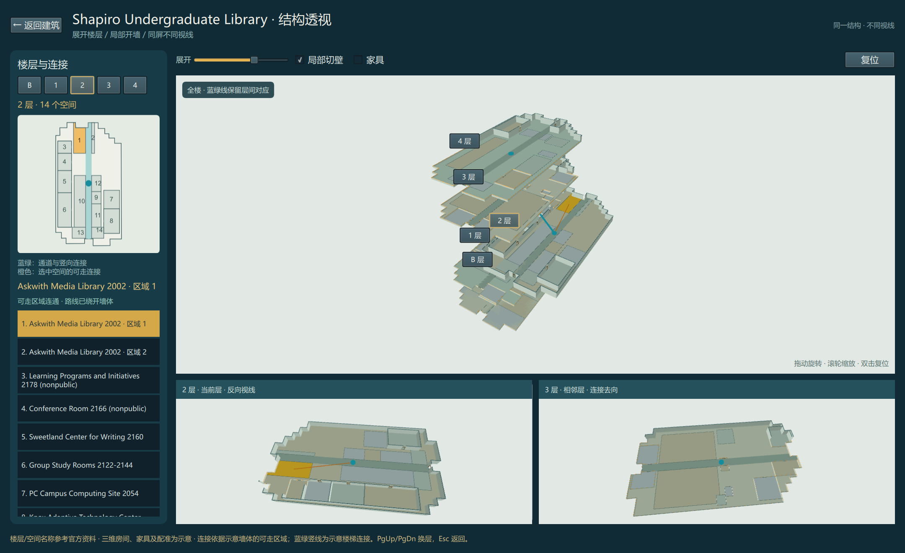
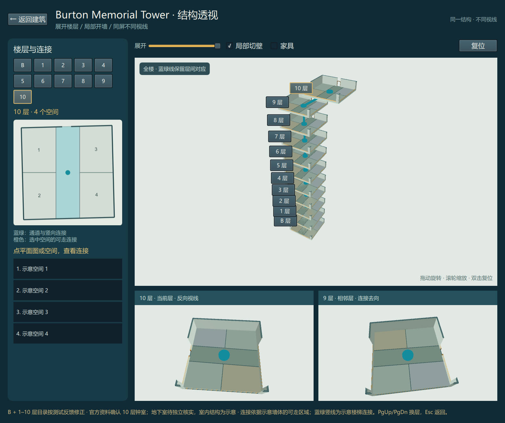
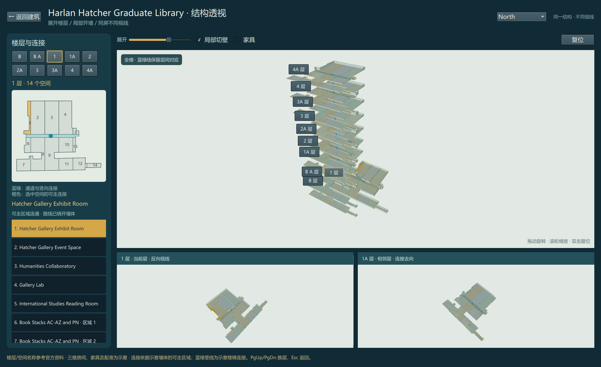

# 结构透视实现与显卡验证

2026-10-15。新分支：`codex/structure-visibility`；基于研究提交`3c5b76b`。手势分支`codex/campus-interiors-environment`没有被合并或重写。

## 怎么看

启动原生应用，打开建筑，点击 **结构透视 · 展开与连接**。

1. 全楼展开，当前层侧向拉出；蓝绿线保留层间示意核心的对应。
2. 左侧楼层图可以点房间；橙色表示选中区域与其可走连接。
3. 下方实时视图分别从反方向观察当前层、观察相邻层，选择同一空间时保持身份一致。
4. “局部切壁”移除视线前的局部墙面上半部分，保留墙脚和远侧上下文；关闭可还原完整墙体。材质保持不透明。
5. 拖动旋转，滚轮缩放，双击或R复位；PgUp/PgDn换层，Esc返回。

## 研究如何落到实现

本轮将楼层展开、局部显露、联动图册和不同视线组合到同一工作区。多透视采用明确标注来源楼层的独立透视视口拼接，**没有实现Graph Camera论文中的通用弯折射线投影**。它以多个投影获得额外可见空间，并用共同空间身份与平面图核对位置。

相机根据当前展开后的完整范围、侧向位移、视角和视口比例构图。Burton在1050像素宽窗口、最大展开量、选中顶层时，B及1–10层仍在画面内。

局部裁剪使用对象坐标中的目标半径、相机方向和0.72m墙脚高度。CPU三角形射线检测使用同一条件；不依赖Qt自定义几何的包围盒拾取，从而避免已裁掉的墙仍捕获点击。Qt的这一限制见[官方Model文档](https://doc.qt.io/qt-6.8/qml-qtquick3d-model.html)。

连接计算使用示意可走区域减去带0.23m间隙的墙体，路径由可见性图求出，并逐段处于允许多边形内。不连通空间不画路径。同一个来源区域被裁成多个不连通部分时，各部分具有独立选择和连接状态；已用Shapiro Wellbeing Room3021的实际生成数据复现并修复错误连接。

## 实际显卡证据

- Windows，PySide6/Qt6.8.3，Direct3D11。
- 渲染日志选中`Intel(R) Iris(R) Xe Graphics`，vendor`0x8086`、device`0xA7A0`、flags`0x0`；不是枚举列表中存在Intel就算通过。
- 覆盖Shapiro、Michigan Union、Burton、Hatcher North与South，共5个建筑/楼翼场景。
- 检查平面图鼠标点击、独立透视中的真实3D鼠标点击、PgDn、Esc、退出重开、M不影响覆盖下的旧视图、切壁还原、展开收拢和窄窗口。
- 每次3D点击前清空选择，避免旧选择造成测试假阳性。5个场景均从空选择成功选中投影目标。
- 生产Main.qml加载，无着色器/绑定/类型错误。摄像头没有启动。
- 旋转更新抽样约18–53次/秒，受场景、桌面负载及测试调度影响；不宣称稳定60FPS，也不是大样本性能基准。

原始[验证结果](previews/structure-visibility/results.json)与[渲染日志](previews/structure-visibility/renderer.log)已保存。完整临时截图位于`.superpowers/structure-visibility-validation`。

## 测试与隔离

最终相关原生测试28项通过，另有1项旧手势信号测试被排除；手势worker/controller两个旧测试模块未纳入这轮相关测试统计。新结构模块的7项测试覆盖不连通空间、绕墙路径、分离空间、拾取裁剪、空包围盒、展开范围、楼翼切换及选择重置。

尝试完整原生套件时，旧`test_worker_signal_reaches_controller_on_gui_thread`仍期望拇指事件立即缩放，旧`test_stop_during_recognition_joins_worker_and_releases_camera`仍期望异步stop立即退出，均失败；另一次临时目录受沙盒限制，相关测试使用项目内独立临时目录后通过。因此**没有声称全套测试通过**。相关手势实现文件与基线完全相同，没有为通过旧预期而修改它们。

新增模块和QML组件承担结构逻辑；已有运行路径仅在`main.py`加入对象、`Main.qml`加入入口和覆盖时的输入隔离。现有截图脚本只补充新的上下文对象。后续合并的共享接触点集中在这三个入口文件。

## 仍然明确的边界

室内墙、门、楼梯位置和层高大多仍是示意模型；官方名称或参考图不等于已完成精确几何配准。蓝绿竖线是示意核心的对应，不是实测楼梯位置。路径只说明当前生成墙体模型连通，并忽略家具，不可用作真实可达性结论。

本轮验证了真实显卡画面和操作，没有开展正式的人类结构理解实验，也没有证明任意复杂楼宇全部细节在同一帧可读。默认视图提供整体关系；局部细节可放大并与楼层图、反向视线核对。
